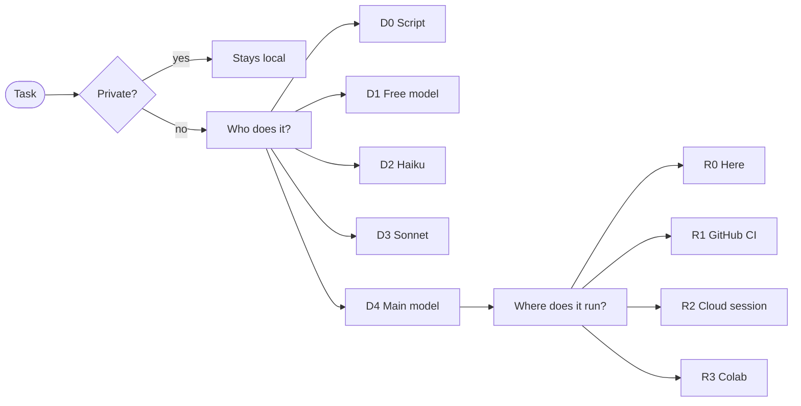

<div align="center">

# route-task

**Same result. Fewer Claude tokens.**

A skill and a short set of always-on rules for [Claude Code](https://claude.com/claude-code). Each part of a job goes to the cheapest tool that does it right.

  

</div>



*A task passes the privacy gate. Then it gets a "who" (D0 to D4) and a "where" (R0 to R3). The cheapest rung that works wins.*

## Results

| Task | Handled by | Without | With | Change |
|---|---|---:|---:|---:|
| Label 600 reviews | Free model | 25,077 | 14,311 | **-43%** |
| Add docstrings to 60 code files | Script + free model | 27,015 | 15,374 | **-43%** |
| Label 200 ambiguous reviews | Free model | 19,111 | 10,690 | **-44%** |
| Seven tasks together | | 121,068 | 88,699 | **-27%** |

Claude tokens used. Jobs under about 20 KB stay with Claude, because handing them off would cost more. Every task and the model that handled it is in [docs/RESULTS.md](docs/RESULTS.md).

## Quickstart

```sh
git clone https://github.com/shifulegend/route-task && cd route-task
sh install.sh
```

`install.sh` backs up what it replaces, copies the files into `~/.claude` and runs `route-doctor`. The doctor lists anything missing and how to fix it. Then:

1. Append `config/CLAUDE.routing.md` to `~/.claude/CLAUDE.md`.
2. Merge `config/settings.hooks.example.json` into `~/.claude/settings.json`.
3. Copy `config/rs-cloud-envs.example.json` to `~/.claude/state/rs-cloud-envs.json` and add your environment ids.

The skill runs the doctor on first use and walks you through whatever is left.

## What you need

- Claude Code, Node 18 or newer, Python 3
- A free-model backend: [OmniRoute](#free-model-backend) or a provider API key

## Free-model backend

`cheap-llm` sends dull text jobs (label, classify, summarise, extract) to a free model. It works with any OpenAI-compatible endpoint:

- **OmniRoute.** Keep your own routing. Use `"auto"` or a combo name.
- **A provider API.** Groq, Gemini, OpenRouter, Mistral, OpenAI. Set `base_url`, a key and that provider's model ids.

Config lives in `~/.claude/cheap-llm.json`. Start from [config/cheap-llm.example.json](config/cheap-llm.example.json). Before each call, `cheap-llm` asks the backend which models it serves and skips the rest.

<details>
<summary>Config keys</summary>

| Key | Meaning |
|---|---|
| `base_url` | OpenAI-compatible endpoint. Default is a local OmniRoute. |
| `api_key_env` | Name of the environment variable that holds your key. |
| `chains` | Model ids to try in order: `default`, `fast`, `code`, `long`, `reason`. Unset chains use `default`. |
| `piece_chain` | Models for the retry in 9 KB pieces, used when a big input fails whole. |
| `private_words` | Your own words (bank, client names) that must never leave the machine. |

Exit codes: `0` done, `3` every model failed or no backend, `4` input looks private and was refused.
</details>

## Privacy first (experimental)

Bank, tax, mail and credentials never go to a free model, CI, the cloud or Colab. They stay on your machine with Claude only, or with no AI at all. `cheap-llm` refuses input that looks private and exits with code `4`. That refusal is final. Add your own sensitive words under `private_words`.

The check is pattern based. It catches the obvious cases, not all of them. Treat it as a safety net, not a guarantee.

## What it does

- **Who (D0 to D4).** Script, free model, Haiku, Sonnet, then the main model.
- **Where (R0 to R3).** This machine, GitHub CI, a cloud session, then Colab. Heavy work never runs on a small server.
- **Size gate.** Under about 20 KB read or 4 KB written, Claude does it. A handover would cost more.
- **Few turns.** A whole list goes in one call. Results are checked with a tool, not read again.
- **Remote sessions.** A hook blocks sessions that break the rules: naming, tags, a limit of 4, a deadline, a ledger.

## Layout

| Path | What |
|---|---|
| `config/` | Always-on rules, hook example, config examples |
| `skills/route-task/` | The procedures |
| `skills/skill-optimizer/` | Writing and A/B-testing skills |
| `agents/` | `haiku-helper`, `sonnet-helper` |
| `bin/` | `cheap-llm`, `rs-guard`, `rs-start`, `route-doctor` |
| `docs/` | Results, architecture |

## Contributing

Open an issue or a pull request. Run `node --check bin/*.mjs` and `python3 -m py_compile bin/rs-guard.py` first. Keep private names and ids out.

## License

[MIT](LICENSE). Built from the [golden-template](https://github.com/shifulegend/golden-template).
