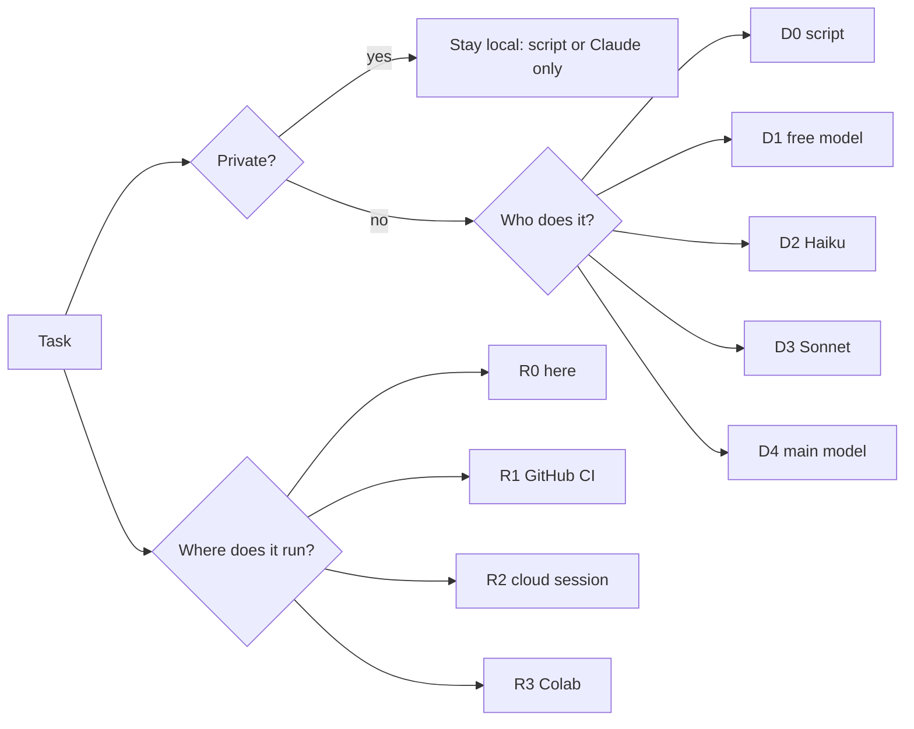

# route-task

Same result, fewer Claude tokens.

 

A Claude Code skill plus a short set of always-on rules. Each part of a task goes to the cheapest tool that does it right. Heavy work goes to the right place. Private data stays on your machine.



*Diagram: a task passes the privacy gate, then gets a "who" tag (D0 to D4) and a "where" tag (R0 to R3).*

## Why
Claude reads and writes every token, and bulk work is mostly reading and writing. A script, a free model or Haiku can do the dull parts for far less. The main model keeps the parts that need judgment.

## Results
Tested with and without the skill on made-up data. Full detail in [docs/RESULTS.md](docs/RESULTS.md).

| Work | Claude cost |
|---|---|
| Label 600 items | 70% cheaper ($0.049 vs $0.164), 598 of 600 right |
| Code descriptions | 55% cheaper |
| Keyword labelling | 12% cheaper (within noise) |
| Summaries, small tasks | 1 to 4 cents dearer |
| Seven tasks together | 31% cheaper ($0.457 vs $0.663) |

Small tasks cost a little more, because the rules are extra text. The always-on rules add about 2,400 tokens, roughly one cent, per session. Each task ran once, and noise is about 15%.

## Quickstart
```sh
git clone https://github.com/shifulegend/route-task && cd route-task
sh install.sh
```
`install.sh` backs up what it replaces, copies the files into `~/.claude`, then runs `route-doctor`. The doctor lists what is missing and how to fix each item. Then finish three steps:

1. Append `config/CLAUDE.routing.md` to `~/.claude/CLAUDE.md`.
2. Merge `config/settings.hooks.example.json` into `~/.claude/settings.json`.
3. Copy `config/rs-cloud-envs.example.json` to `~/.claude/state/rs-cloud-envs.json` and add your own environment ids.

The skill also runs the doctor on first use and walks you through anything still open.

## Prerequisites
- Claude Code
- Node 18 or newer, Python 3
- Optional: a free-model backend, `gh`, the `colab` CLI, `agy`, agent teams

## Free models
Free models are optional. Without a backend, the rules use Haiku and the saving is smaller. Nothing breaks.

`cheap-llm` works with any OpenAI-compatible endpoint:
- **OmniRoute:** keep your own routing and combos. Use `"auto"` or a combo name.
- **A provider API:** Groq, Gemini, OpenRouter, Mistral, OpenAI and others. Set `base_url`, a key in an environment variable, and that provider's model ids.

Config lives in `~/.claude/cheap-llm.json`. Start from [config/cheap-llm.example.json](config/cheap-llm.example.json).

<details>
<summary>Config keys</summary>

| Key | Meaning |
|---|---|
| `base_url` | OpenAI-compatible endpoint. Default is a local OmniRoute. |
| `api_key_env` | Name of the environment variable that holds your key. |
| `chains` | Model ids to try in order: `default`, `fast`, `code`, `long`, `reason`. Unset chains use `default`. |
| `piece_chain` | Models for the retry in 9 KB pieces, used when a big input fails whole. |
| `private_words` | Your own words (bank, client names) that must never leave the machine. |

Exit codes: `0` done, `3` every model failed or no backend, `4` input looks private and was refused.
</details>

## What it does
- **Privacy first.** Bank, tax, mail and credentials stay local. The scripts refuse input that looks private.
- **Who (D0 to D4).** Script, then free model, then Haiku, then Sonnet, then the main model. The cheapest rung that works.
- **Where (R0 to R3).** This machine, then GitHub CI, then a cloud session, then Colab. Heavy work never runs on a small server.
- **Size gate.** Under about 20 KB read or 4 KB written, the main model does it. A handover would cost more.
- **Few turns.** Whole lists go in one call. Results are checked with a tool, not by reading them again.
- **Remote sessions.** A hook blocks sessions that break the rules: naming, tags, a limit of 4, a deadline, a ledger.

## Layout
| Path | What |
|---|---|
| `config/` | Always-on rules, hook example, config examples |
| `skills/route-task/` | The procedures |
| `skills/skill-optimizer/` | Writing and A/B-testing skills |
| `agents/` | `haiku-helper`, `sonnet-helper` |
| `bin/` | `cheap-llm`, `agy-ask`, `rs-guard`, `rs-start`, `route-doctor` |
| `docs/` | Results, architecture, project memory |

## Limits
- Each task ran once. Treat the numbers as a guide.
- Bulk text work saves the most. Small tasks do not.
- The Colab notes describe the author's setup. Adapt them.

## Contributing
Open an issue or a pull request. Run `node --check bin/*.mjs` and `python3 -m py_compile bin/rs-guard.py` first. Keep private names and ids out.

## License
[MIT](LICENSE). Built from the [golden-template](https://github.com/shifulegend/golden-template).
